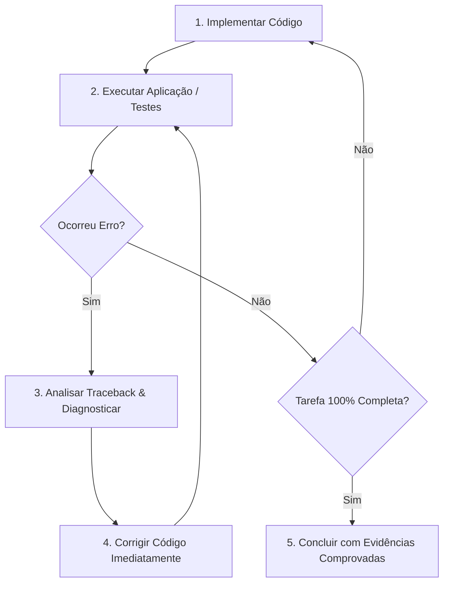

# AGENTS.md - Diretrizes de Engenharia e Validação Contínua

Este arquivo define as regras estritas e obrigatórias de execução para qualquer agente de IA operando neste repositório.

---

## 🚨 Regra de Ouro: Execução Contínua e Tolerância Zero a Erros

> **O agente DEVE executar a aplicação a cada nova implementação, NÃO PODE finalizar antes de concluir a tarefa inteira, e SÓ PODE PARAR quando o código rodar com ZERO ERROS.**

---

## 1. Ciclo Obrigatório de Implementação (Run-After-Implementation Loop)

A cada alteração, adição de funcionalidade ou refatoração no código, o agente deve seguir rigorosamente o ciclo abaixo:



### Protocolo de Validação por Camada:
1. **Backend (Python / FastAPI / Motor de Recomendação)**:
   - Executar os testes automatizados da API:
     ```powershell
     python test_api.py
     ```
     ou
     ```powershell
     pytest
     ```
   - Validar se a API sobe sem erros e se os endpoints afetados respondem com HTTP 200.
2. **Frontend (`totem-ui` - React / Vite)**:
   - Validar a compilação e tipagem do frontend:
     ```powershell
     cd totem-ui; npm run build
     ```
   - Garantir que o linter não reporte erros bloqueantes:
     ```powershell
     cd totem-ui; npm run lint
     ```
3. **E2E & Testes de Interface**:
   - Utilizar o MCP do Playwright (`@playwright/mcp`) ou Chrome DevTools para inspecionar componentes, interações e fluxos visuais.

---

## 2. Regra de Não Parada (Never Stop on Errors)

* **Proibido desistir com erro**: O agente NUNCA deve interromper a execução, devolver a mensagem ou pedir para o usuário corrigir um erro que ocorreu durante a implementação.
* **Resolução Autônoma**:
  1. Capturar o traceback exato ou log de falha.
  2. Localizar o arquivo e linha responsáveis.
  3. Aplicar a correção diretamente no código.
  4. Executar o comando novamente.
  5. Repetir o processo até a resolução completa (Exit Code 0).

---

## 3. Critério de Conclusão da Tarefa (Definition of Done)

Uma tarefa só pode ser marcada como finalizada e comunicada ao usuário quando TODAS as seguintes condições forem verdadeiras:

1. **Escopo Completo**: 100% dos requisitos solicitados foram desenvolvidos (sem pendências ou "TODOs" funcionais).
2. **Execução Bem-Sucedida**: Os comandos de validação foram executados diretamente no terminal e a saída confirmou sucesso.
3. **Zero Erros**: 0 erros de sintaxe, 0 erros de compilação, 0 exceções não tratadas e 0 testes falhando.
4. **Evidência Comprovada**: O agente apresenta o resultado real comprovando que a aplicação rodou perfeitamente.

---

## 4. Princípios Superpowers Ativos

* **`verification-before-completion`**: Evidência antes de afirmação. Nunca diga que "o código funciona" sem ter executado o teste e inspecionado a saída.
* **`systematic-debugging`**: Em caso de falha, investigue a causa raiz através dos logs antes de modificar arquivos aleatoriamente.
