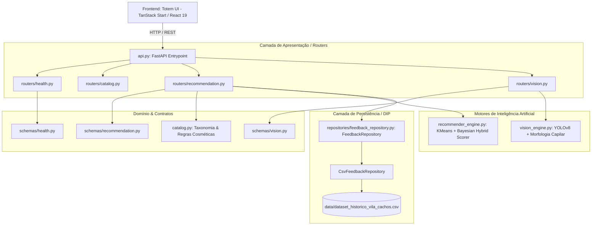

# Arquitetura de Software - Vila Cachos AI

Este documento detalha os padrões arquiteturais, limites de contexto (Bounded Contexts) e a árvore organizada de arquivos do ecossistema **Vila Cachos AI**.

---

## 1. Visão Geral da Arquitetura

O sistema implementa **Clean Architecture** e princípios de **Domain-Driven Design (DDD)**, complementados pelo framework de 6 estágios para motores de recomendação (*Source → Hydrator → Filter → Scorer → Selector → SideEffect*).



---

## 2. Bounded Contexts (Contextos Delimitados)

1. **Contexto de Recomendação e Segmentação**:
   - Responsável pelo agrupamento de personas (KMeans em $\mathbb{R}^8$) e scoring híbrido (*Knowledge-Based* + *Bayesian Feedback*).
   - Componentes: `recommender_engine.py`, `routers/recommendation.py`, `schemas/recommendation.py`.
2. **Contexto de Catálogo e Farmacologia Cosmética**:
   - Responsável pelos dados de produtos, afinidade de curvaturas (2A-4C), pH e ingredientes.
   - Componentes: `catalog.py`, `routers/catalog.py`.
3. **Contexto de Visão Computacional (Diagnóstico Visual)**:
   - Responsável pela inferência de textura, frizz e curvatura com *Human-in-the-Loop*.
   - Componentes: `vision_engine.py`, `routers/vision.py`, `schemas/vision.py`.
4. **Contexto de Persistência e Auditoria**:
   - Interface abstrata para armazenamento analítico desacoplado da infraestrutura web.
   - Componentes: `repositories/feedback_repository.py`.

---

## 3. Árvore Estruturada de Arquivos

```text
├── .agents/                        # Skills ativas do agente de IA (Antigravity)
│   └── skills/                     # software_architecture, senior-architect, recsys, etc.
├── assets/                         # Modelos treinados (.pt, .onnx) e mídias visuais
├── data/                           # Base analítica histórica
│   └── dataset_historico_vila_cachos.csv
├── docs/                           # Documentação e decisões arquiteturais
│   ├── architecture/
│   │   ├── adr-001-clean-architecture-persistence-and-routers.md
│   │   └── SOFTWARE_ARCHITECTURE.md
│   └── superpowers/plans/          # Planos de implementação estruturados
├── repositories/                   # Camada de Persistência (Clean Architecture - DIP)
│   ├── __init__.py
│   └── feedback_repository.py      # FeedbackRepository (ABC) & CsvFeedbackRepository
├── routers/                        # Módulos de Rotas (APIRouter)
│   ├── __init__.py
│   ├── catalog.py                  # GET /catalogo
│   ├── health.py                   # GET / e GET /health
│   ├── recommendation.py           # POST /recommend e POST /feedback
│   └── vision.py                   # POST /diagnostico/imagem
├── schemas/                        # Contratos Pydantic de entrada/saída
│   ├── __init__.py
│   ├── health.py                   # HealthResponse
│   ├── recommendation.py           # ClienteProfile, FeedbackInput, etc.
│   └── vision.py                   # VisionDiagnosisResponse
├── tests/                          # Suítes de testes unitários e de integração
│   ├── test_repository.py          # Testes unitários do repositório
│   └── test_api.py                 # Testes de integração de endpoints
├── totem-ui/                       # Aplicação Frontend (TanStack Start / React 19)
│   ├── src/                        # Componentes, rotas e hooks
│   └── eslint.config.js            # Linter configurado com 0 avisos
├── api.py                          # Orquestrador principal da API (<90 linhas)
├── catalog.py                      # Catálogo e taxonomia de produtos
├── recommender_engine.py           # Motor de recomendação híbrido
└── vision_engine.py                # Classificador de visão computacional
```
