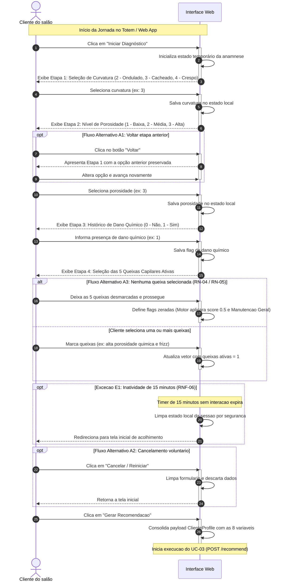
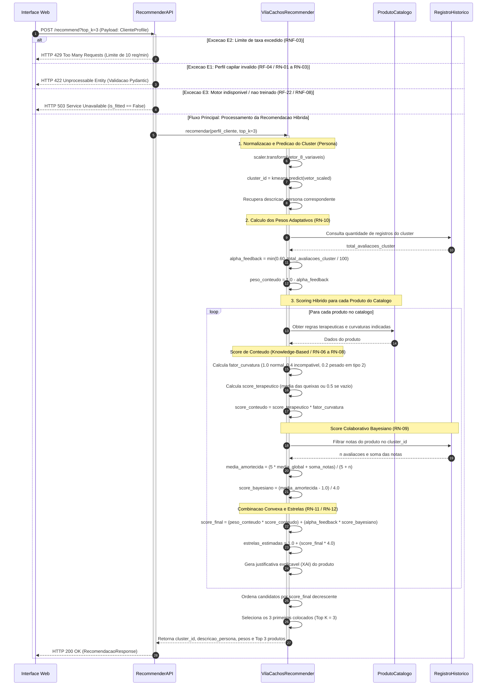
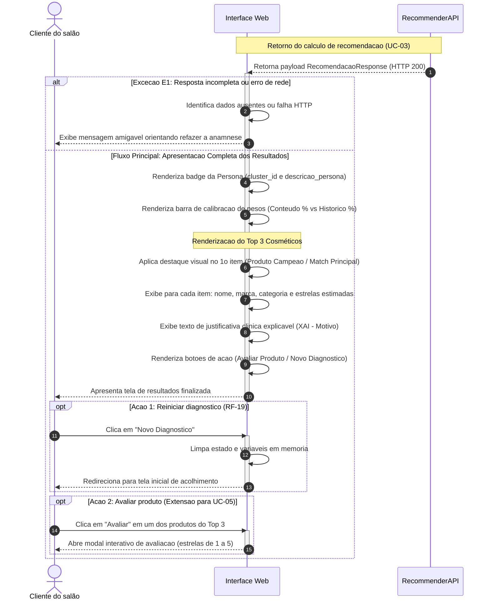
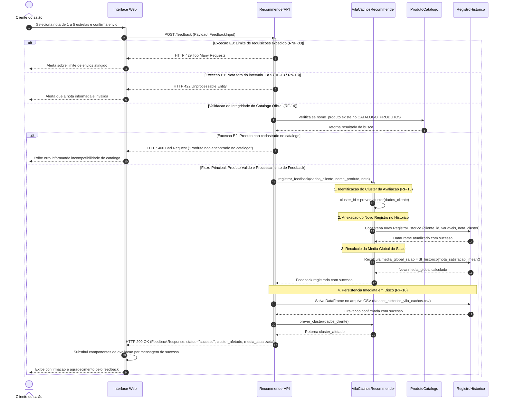
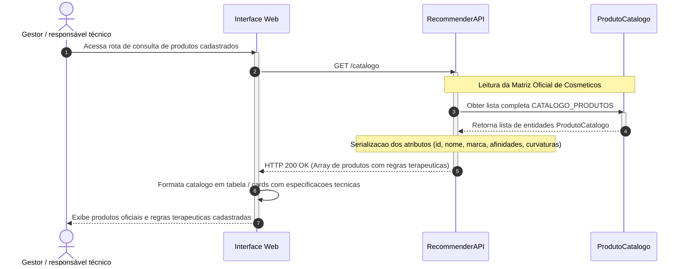
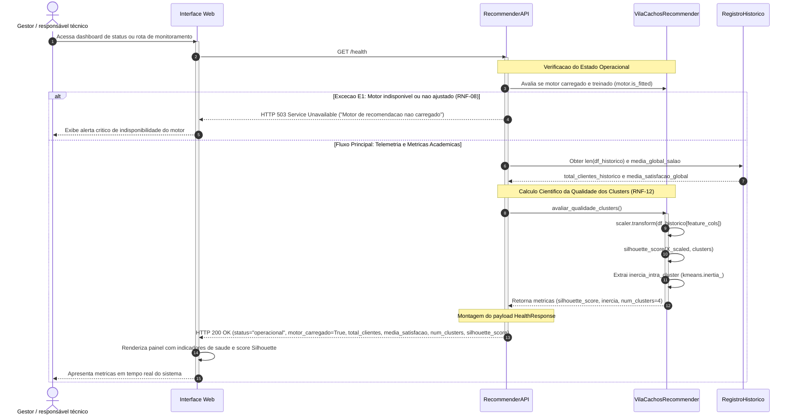

# Diagramas de Sequência do Sistema Vila Cachos AI

Este documento contém os **Diagramas de Sequência UML em Mermaid.js** modelados especificamente para atender à documentação da disciplina de **Análise 2**. Cada diagrama foi projetado para modelar com fidelidade os fluxos principais, fluxos alternativos, regras de negócio (RN) e requisitos funcionais (RF/RNF) do projeto, além de ser **100% compatível com importação direta no draw.io** (`Arrange/Insert > Advanced > Mermaid`).

---

## 📋 Tabela de Correlação dos Diagramas

| Diagrama | Caso de Uso | Atores Envolvidos | Requisitos Funcionais | Regras de Negócio |
| :--- | :--- | :--- | :--- | :--- |
| **Diagrama 1** | **UC-02**: Preencher anamnese capilar | Cliente do salão / Profissional | RF-01, RF-02, RF-03, RF-19, RF-21 | RN-01, RN-02, RN-03, RN-04, RN-05 |
| **Diagrama 2** | **UC-03**: Gerar recomendação híbrida | Cliente do salão / Profissional | RF-04 a RF-11, RF-22 | RN-01 a RN-12, RN-14 |
| **Diagrama 3** | **UC-04**: Visualizar diagnóstico e recomendações | Cliente do salão / Profissional | RF-10, RF-11, RF-12, RF-19 | RN-11, RN-12, RN-14 |
| **Diagrama 4** | **UC-05**: Registrar feedback de produto | Cliente do salão | RF-13 a RF-16, RF-22 | RN-13, RN-15, RNF-03 |
| **Diagrama 5** | **UC-06**: Consultar catálogo | Gestor / responsável técnico | RF-17, RNF-11 | RN-06, RN-07 |
| **Diagrama 6** | **UC-07**: Monitorar saúde e métricas | Gestor / responsável técnico | RF-18, RNF-08, RNF-12 | RN-09, RNF-08 |

---

## 🛠️ Como Importar no draw.io
1. Abra o [draw.io](https://app.diagrams.net/).
2. No menu superior, clique em **+ (Insert)** ou **Arrange** -> **Insert** -> **Advanced** -> **Mermaid**.
3. Copie o bloco de código Mermaid de um dos diagramas abaixo e cole na caixa de texto.
4. Clique em **Insert**. O draw.io converterá automaticamente o código em formas nativas e editáveis.

---

## 1. Diagrama de Sequência: UC-02 - Preencher Anamnese Capilar

### Escopo e Detalhes
* **Caso de Uso:** UC-02 - Preencher anamnese capilar
* **Objetivo:** Coletar, de forma guiada em 4 etapas, as características necessárias para formar o perfil capilar de 8 variáveis.
* **Atores e Participantes:**
  * `Cliente do salão` (ou Profissional do salão)
  * `Interface Web` (Totem UI / Wizard em React)
* **Fluxos Modelados:**
  * Fluxo Principal: 4 passos sequenciais (Curvatura 2/3/4, Porosidade 1/2/3, Dano Químico 0/1 e 5 Queixas).
  * Fluxo Alternativo A1: Voltar etapa sem perda de seleções.
  * Fluxo Alternativo A2: Cancelar e retornar à tela inicial.
  * Fluxo Alternativo A3: Nenhuma queixa selecionada (aplica regra RN-04 / RN-05 de manutenção geral).
  * Exceção E1 (RNF-06): Timeout de inatividade de 15 minutos limpando o estado da sessão.

---

## 2. Diagrama de Sequência: UC-03 - Gerar Recomendação Híbrida

### Escopo e Detalhes
* **Caso de Uso:** UC-03 - Gerar recomendação híbrida
* **Objetivo:** Classificar o perfil biofísico capilar com K-Means e gerar ranking personalizado Top-3 combinando afinidade de conteúdo e média bayesiana amortecida.
* **Participantes:**
  * `Interface Web` (Client HTTP)
  * `RecommenderAPI` (FastAPI / Rotas)
  * `VilaCachosRecommender` (Motor de IA e Regras)
  * `ProdutoCatalogo` (Matriz Terapêutica)
  * `RegistroHistorico` (DataFrame / CSV)
* **Regras de Negócio e Fórmulas:**
  * Validação Pydantic (RN-01 a RN-03).
  * Normalização via StandardScaler e predição de cluster (4 personas).
  * Peso adaptativo: $\alpha_{feedback} = \min(0.60, N_{cluster}/100)$ e $peso_{conteudo} = 1.0 - \alpha_{feedback}$.
  * Afinidade de conteúdo (fator de curvatura 1.0 / 0.4 / 0.2 e queixas ativas).
  * Média Bayesiana amortecida: $S = \frac{C \cdot m + \sum notas}{C + n}$ com $C=5$ e $m=\text{média global}$.
  * Estimativa de estrelas: $1 + 4 \cdot score\_final$.
  * Tratamento de exceções HTTP 422, 429 e 503.

---

## 3. Diagrama de Sequência: UC-04 - Visualizar Diagnóstico e Recomendações

### Escopo e Detalhes
* **Caso de Uso:** UC-04 - Visualizar diagnóstico e recomendações
* **Objetivo:** Apresentar o resultado em formato compreensível para apoiar a decisão de compra ou tratamento, exibindo a persona, proporção de pesos, Top 3 ranqueado com estrelas estimadas e justificativas.
* **Atores e Participantes:**
  * `Cliente do salão` (ou Profissional do salão)
  * `Interface Web` (Totem UI em React)
  * `RecommenderAPI` (Provedor de Dados)
* **Regras de Negócio e Funcionalidades:**
  * Exibição de persona identificada e peso adaptativo (regras vs feedback).
  * Destaque visual de 1º lugar (Melhor recomendação).
  * Tratamento de resposta incompleta (Exceção E1).
  * Pontos de extensão: Iniciar novo diagnóstico (RF-19) ou Avaliar produto (UC-05).

---

## 4. Diagrama de Sequência: UC-05 - Registrar Feedback de Produto

### Escopo e Detalhes
* **Caso de Uso:** UC-05 - Registrar feedback de produto
* **Objetivo:** Registrar a satisfação observada pós-atendimento (nota de 1 a 5 estrelas) e alimentar a base histórica para recalibrar futuras recomendações bayesianas.
* **Participantes:**
  * `Cliente do salão`
  * `Interface Web`
  * `RecommenderAPI`
  * `VilaCachosRecommender`
  * `ProdutoCatalogo`
  * `RegistroHistorico` (DataFrame / CSV)
* **Regras de Negócio e Validações:**
  * Nota inteira de 1 a 5 (RN-13 / HTTP 422 se inválida).
  * Produto obrigatoriamente pertencente ao catálogo oficial (RF-14 / HTTP 400 se desconhecido).
  * Re-predição do cluster do perfil avaliado para correta amarração do feedback (RF-15).
  * Atualização da média global de satisfação do salão e persistência imediata em CSV (RF-16).
  * Rate limit de proteção contra spam (RNF-03 / HTTP 429).

---

## 5. Diagrama de Sequência: UC-06 - Consultar Catálogo

### Escopo e Detalhes
* **Caso de Uso:** UC-06 - Consultar catálogo
* **Objetivo:** Obter a lista oficial de produtos, categorias, curvaturas indicadas, pesos de formulação e matriz de afinidades terapêuticas com as queixas capilares.
* **Atores e Participantes:**
  * `Gestor / responsável técnico`
  * `Interface Web` (ou Cliente Técnico / Postman)
  * `RecommenderAPI`
  * `ProdutoCatalogo`
* **Requisitos Relacionados:**
  * RF-17: Disponibilização do catálogo oficial via API.
  * RNF-11: Manutenibilidade e separação estrita de catálogo.

---

## 6. Diagrama de Sequência: UC-07 - Monitorar Saúde e Métricas

### Escopo e Detalhes
* **Caso de Uso:** UC-07 - Monitorar saúde e métricas
* **Objetivo:** Verificar se o motor de IA está operacional (`is_fitted`) e inspecionar em tempo real o volume de atendimentos históricos, média global de satisfação e qualidade científica da clusterização (Silhouette Score e Inércia).
* **Atores e Participantes:**
  * `Gestor / responsável técnico`
  * `Interface Web` (Dashboard de Telemetria / Swagger)
  * `RecommenderAPI`
  * `VilaCachosRecommender`
  * `RegistroHistorico` (DataFrame)
* **Requisitos Relacionados:**
  * RF-18: Endpoint `/health` com estado do motor e métricas.
  * RNF-08: Rota de monitoramento independente da inferência.
  * RNF-12: Qualidade científica com validação por Silhouette Score.

---

## 🎯 Resumo da Conformidade com a Engenharia de Software

1. **Alinhamento com o Diagrama de Classes**: Lifelines exatamente espelhadas em `RecommenderAPI`, `VilaCachosRecommender`, `ClienteProfile`, `ProdutoCatalogo` e `RegistroHistorico`.
2. **Cobertura Completa das Exceções**: Modelados os status codes `HTTP 400` (produto desconhecido), `HTTP 422` (falha de tipagem/domínio), `HTTP 429` (rate limit) e `HTTP 503` (motor não ajustado).
3. **Compatibilidade Draw.io**: Uso exclusivo de sintaxe pura Mermaid, com nomes de setas legíveis, blocos `activate/deactivate` balanceados e sem caracteres incompatíveis.
