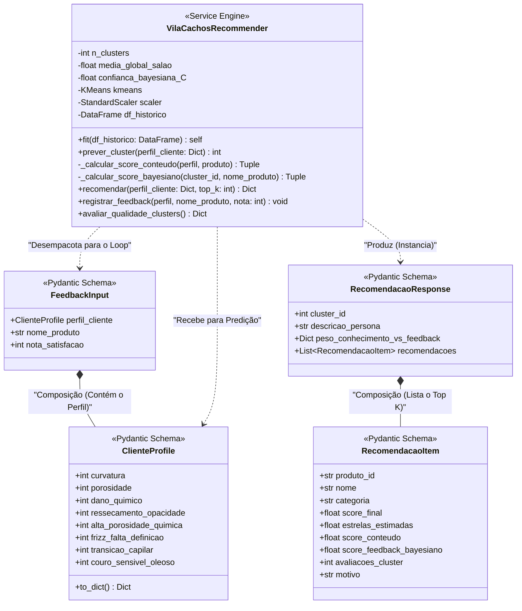
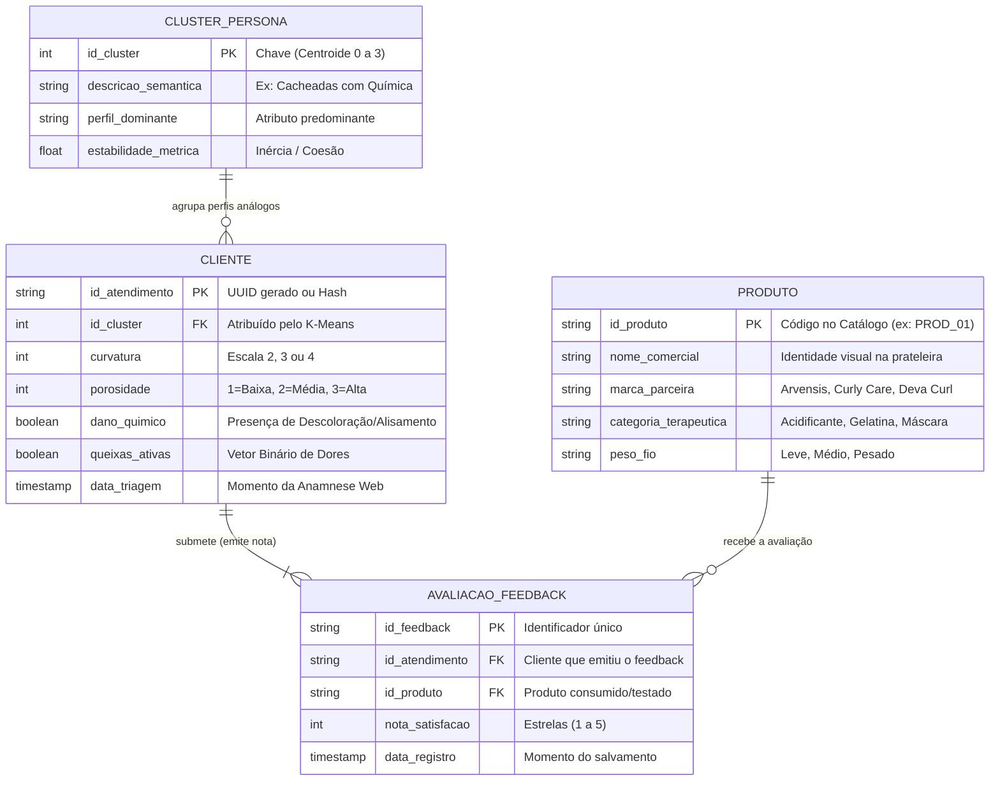

# Modelagem Arquitetural de Dados e Classes (Back-end)
**Projeto:** Web App de Diagnóstico Capilar com IA Híbrida para a Vila Cachos  
**Módulo:** Motor de Recomendação e Interface de Persistência Analítica  
**Notação:** UML (Class Diagram) e MER/ERD em Mermaid.js  

---

## 1. Diagrama de Classes (UML)

O Diagrama de Classes a seguir mapeia a estrutura estática do serviço de *back-end* desenvolvido em Python (FastAPI). Ele exibe os **Contratos de Dados** (Pydantic Schemas) para validação rigorosa das entradas e saídas da API, bem como a classe central analítica do motor híbrido (`VilaCachosRecommender`), que orquestra as bibliotecas de Machine Learning (Scikit-Learn).

---

## 2. Modelo Entidade-Relacionamento (ERD / MER)

Este diagrama representa o modelo lógico relacional desenhado para suportar e persistir os atendimentos, as inferências algorítmicas e o histórico colaborativo necessário para calcular a *Média Bayesiana Amortecida* e superar progressivamente o *Cold Start*.

---

## 3. Dicionário de Dados Resumido

A tabela abaixo especifica o papel semântico de cada uma das quatro entidades que formam a espinha dorsal de persistência do modelo híbrido de recomendação da Vila Cachos.

| Entidade | Papel no Domínio do Salão e no Motor de Recomendação |
| :--- | :--- |
| **`CLUSTER_PERSONA`** | Entidade gerenciada exclusivamente pelo algoritmo K-Means. Armazena a interpretação clínica dos $k=4$ centroides encontrados (as "Personas" do salão). Usada como pivô geográfico para calcular a média colaborativa local sem que misturemos cabelos crespos saudáveis com ondulados danificados. |
| **`CLIENTE`** | Representa a foto do estado biofísico de um atendimento pontual submetido no Web App. Armazena o vetor de 8 dimensões coletado na anamnese e a chave primária que ligará esse quadro capilar único a eventuais feedbacks posteriores. |
| **`PRODUTO`** | Repositório oficial do catálogo (A matriz *Knowledge-Based* a frio). Contém as regras duras de negócio, restrições químicas (não sugerir cremes pesados para fios finos/ondulados), categorias de ação e as *labels* das marcas homologadas pela Vila Cachos. |
| **`AVALIACAO_FEEDBACK`** | O combustível essencial do *Feedback Loop Bayesiano*. Sempre que uma cliente retorna uma nota explícita (1 a 5 estrelas), essa entidade é gravada. O motor de recomendação varre esses registros para recalibrar iterativamente os pesos do algoritmo, reduzindo aos poucos a dependência de palpites humanos iniciais e firmando o modelo estatisticamente sobre dados reais de satisfação. |
