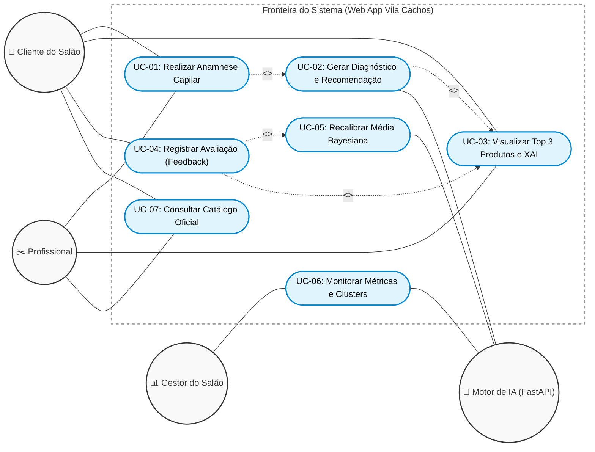
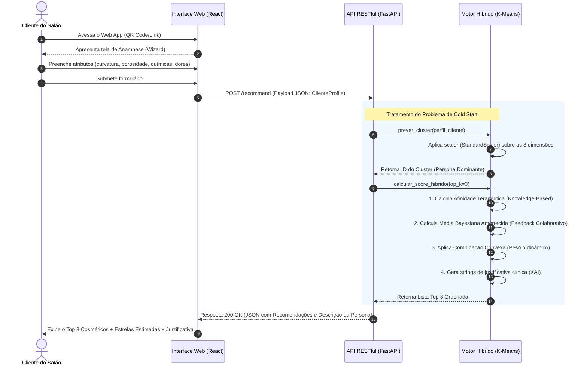

# Modelagem UML: Sistema Híbrido Vila Cachos

Este documento contém a diagramação formal dos fluxos funcionais mapeados no sistema **Vila Cachos AI**, empregando notação UML adaptada para renderização nativa via Mermaid.js.

---

## 1. Diagrama de Casos de Uso (Visão Geral)

O diagrama abaixo delineia a fronteira do sistema (*System Boundary*) e as associações diretas entre os quatro atores principais e os casos de uso de negócio.

---

## 2. Diagrama de Sequência (O Fluxo Crítico de Cold Start)

Este diagrama detalha o processo interativo onde uma cliente (mesmo sem histórico prévio na base do salão) realiza a anamnese, interage com a API e recebe as recomendações derivadas da combinação do aprendizado não-supervisionado com o mapeamento especializado (XAI).

---

## 3. Especificação Formal de Casos de Uso

Abaixo encontram-se as descrições de alto rigor da Engenharia de Software para os dois casos de uso arquiteturalmente mais complexos, cobrindo o fluxo principal (happy path) e as exceções.

### UC-01: Geração de Diagnóstico e Recomendação Híbrida

*   **Atores Principais:** Cliente do Salão.
*   **Atores Secundários:** Profissional Cabeleireiro, Motor de IA.
*   **Objetivo:** Processar o quadro biofísico capilar e queixas clínicas informadas para gerar uma indicação algorítmica dos 3 melhores cosméticos do catálogo, mitigando o *Cold Start*.
*   **Pré-condições:** O sistema deve estar operacional, o modelo K-Means deve estar carregado e previamente ajustado (`is_fitted=True`) com a constante bayesiana populada. A interface do usuário não pode estar em estado de timeout.

**Fluxo Principal (Happy Path):**
1. O Cliente seleciona "Iniciar Diagnóstico" no Web App.
2. O sistema exibe o Wizard de 8 variáveis (Curvatura, Porosidade, Danos Químicos, Queixas Ativas).
3. O Cliente (opcionalmente auxiliado pelo Profissional) preenche todos os campos obrigatórios.
4. O Cliente aciona a submissão do formulário.
5. A Interface valida o modelo de dados localmente e dispara uma requisição `POST /recommend`.
6. O Motor de IA recebe o vetor, normaliza os dados com o `StandardScaler` e infere a Persona usando K-Means.
7. O Motor calcula os scores `Knowledge-Based` baseados nas queixas mapeadas e cruza com a Média Bayesiana Amortecida do Cluster.
8. O Motor retorna o array das 3 recomendações de maior pontuação com suas respectivas justificativas (XAI).
9. A Interface renderiza os resultados, destacando a compatibilidade terapêutica para a cliente.

**Fluxos de Exceção:**
*   *FE-01: Inatividade do Cliente (Timeout).* Se o cliente permanecer 15 minutos sem interação durante o preenchimento, o componente React força um reinício global da sessão (limpeza do state). O fluxo é encerrado por questões de privacidade e economia de infraestrutura.
*   *FE-02: Limite de Requisições Atingido (Rate Limit).* Se o mesmo IP disparar o cálculo mais de 10 vezes por minuto, a API aborta a inferência e retorna `HTTP 429 Too Many Requests`. O Web App notifica o cliente para aguardar alguns instantes antes de tentar novamente.
*   *FE-03: Motor Indisponível.* Se o modelo não estiver carregado na memória do servidor, a API retorna `HTTP 503 Service Unavailable`. O sistema orienta contatar a administração do salão.

---

### UC-02: Calibração de Pesos via Feedback Loop Bayesiano

*   **Atores Principais:** Cliente do Salão.
*   **Atores Secundários:** Motor de IA.
*   **Objetivo:** Fechar o ciclo de recomendação capturando a validação empírica pós-atendimento. A nota submetida atuará dinamicamente para ancorar futuras recomendações a dados reais (Collaborative Filtering iterativo).
*   **Pré-condições:** O Cliente deve ter passado por um atendimento e ter ciência do cosmético utilizado. O perfil capilar do cliente (vetor de 8 variáveis) deve estar preservado no estado da requisição.

**Fluxo Principal (Happy Path):**
1. A partir da visualização das recomendações (`UC-03`), o Cliente clica em "Avaliar Resultado".
2. O sistema exibe um modal solicitando a confirmação do nome do produto utilizado e a seleção da nota de satisfação de 1 a 5 estrelas.
3. O Cliente preenche a avaliação e confirma o envio.
4. A Interface dispara uma requisição `POST /feedback` com o pacote `FeedbackInput`.
5. O Motor de IA recebe o payload e verifica a integridade do nome do produto no Catálogo Oficial.
6. O Motor deduz a qual Cluster a avaliação pertence utilizando a mesma inferência do K-Means.
7. O Motor registra a nova nota no banco de dados analítico e atualiza a Média Global do salão em tempo real.
8. A API retorna `HTTP 200 OK` informando que o feedback foi persistido.
9. A Interface agradece a cliente pela colaboração e encerra a jornada ativa.

**Fluxos de Exceção:**
*   *FE-01: Produto Não Reconhecido.* Caso, por injeção ou falha de sincronia, a interface envie um produto ausente no `catalog.py`, o Back-end rejeita o input com `HTTP 400 Bad Request` informando o descompasso de catálogo. O Motor bloqueia a gravação para não corromper o dataset.
*   *FE-02: Rate Limit de Feedback (Abuso/Spam).* Se o IP enviar excesso de formulários num período curto, o mecanismo de SlowAPI barra a requisição (`HTTP 429`) protegendo a Média Bayesiana de poluição maliciosa.
