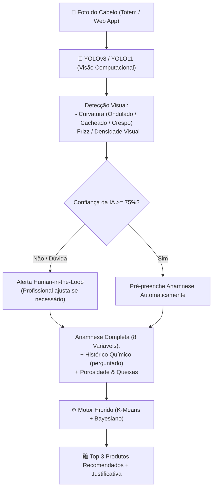

# Plano de Implementação e Escrita Acadêmica: Módulo YOLO no Vila Cachos AI

> **Documento de Planejamento Integrado para TCC (Sistemas de Informação - IFMA)**  
> **Projeto:** Vila Cachos AI — Sistema Especialista Multimodal de Diagnóstico e Recomendação Capilar  
> **Autor:** Marcos Vinícius  
> **Data:** Outubro de 2026  

---

## 1. Visão Geral e Alinhamento Conceitual

### 1.1 O Desafio Real no Salão e a Solução Multimodal
Atualmente, o **Vila Cachos AI** possui um núcleo de recomendação validado e em pleno funcionamento:
- **8 variáveis de anamnese** coletadas via formulário.
- **Segmentação em 4 Personas** via algoritmo não-supervisionado **K-Means**.
- **Ranqueamento de produtos** com mitigação de *Cold Start* via **Média Bayesiana Amortecida** e regras explicáveis (**XAI**).

**O gargalo identificado:**  
A avaliação humana de variáveis visuais (principalmente **curvatura do fio 2/3/4** e **nível de frizz**) é altamente subjetiva. Duas profissionais diferentes podem classificar o mesmo cabelo de formas distintas.

**A Solução com YOLO (*You Only Look Once*):**  
Incorporar um **Módulo de Visão Computacional** na entrada do sistema. A cliente ou profissional tira uma foto do cabelo no totem/celular, o **YOLO** processa a imagem em tempo real, detecta a região capilar, classifica a textura/curvatura e pré-preenche as perguntas visuais da anamnese.

---

## 2. O que Escrever no Texto da Monografia (Adiantar a Escrita)

Aqui está o roteiro estruturado do que redigir em cada capítulo do seu TCC para fundamentar o YOLO:

### 📄 Capítulo 1: Introdução e Justificativa
- **Problema de Pesquisa:** A subjetividade e variabilidade do olho humano no diagnóstico capilar presencial.
- **Objetivo da Visão:** Explicar que a adição do YOLO transforma o Vila Cachos AI em um **sistema multimodal híbrido** (unindo Visão Computacional + Aprendizado Tabular + Inferência Bayesiana).
- **Contribuição:** Pioneirismo na digitalização visual de cabelos com curvatura (tipos 2, 3 e 4), categoria historicamente sub-representada em datasets de visão computacional.

### 📄 Capítulo 2: Fundamentação Teórica
- **Redes Neurais Convolucionais e Arquitetura YOLO (You Only Look Once):**
  - Diferença entre modelos *two-stage* (como Faster R-CNN, mais lentos) e *single-stage* (família YOLO, tempo real).
  - Justificativa da escolha do **YOLOv8 / YOLO11** (Ultralytics): leveza para rodar em hardware comum de salão (CPU ou GPU básica) e facilidade de *transfer learning*.
- **Classificação de Curvatura Capilar:** Escala de André Walker (Tipos 2, 3 e 4) e padrões morfológicos dos fios.
- **Conceito de *Human-in-the-Loop* (HITL):** A IA atua como co-piloto da cabeleireira; se a confiança for baixa, a profissional valida a imagem, garantindo precisão clínica.

### 📄 Capítulo 3: Metodologia e Arquitetura Proposta
- **Diagrama de Blocos da Solução:** Fluxo completo da captura à inferência.
- **Protocolo de Captura de Imagens:** Distância padronizada, fundo neutro, iluminação de salão e termo de consentimento (conformidade com LGPD).
- **Métricas de Avaliação de Visão:**
  - $mAP@50$ (Mean Average Precision).
  - Matriz de Confusão entre classes (Ondulado vs. Cacheado vs. Crespo).
  - Precisão, Revocação e F1-Score por tipo de fio.

### 📄 Capítulo 4: Desenvolvimento e Engenharia de Software
- **Pipeline de Inferência no Back-end:** Como a imagem chega via `multipart/form-data`, passa pelo pré-processamento (OpenCV/Pillow), é inferida pelo PyTorch/Ultralytics e convertida em JSON.
- **Integração no Front-end (React):** Criação do componente com acesso à webcam via `navigator.mediaDevices` ou upload de galeria, exibindo a confiança e a sugestão das respostas.

### 📄 Capítulo 5: Resultados e Discussão
- **Desempenho da Inferência:** Tempo médio de resposta por foto (ex: ~120ms em GPU ou ~350ms em CPU).
- **Impacto no Tempo de Atendimento:** Comparação de tempo gasto para preencher a anamnese (manual: ~3 minutos vs. assistida por YOLO: ~45 segundos).
- **Concordância com Especialistas:** Índice Kappa de Cohen entre o diagnóstico da cabeleireira sênior e a predição do modelo.

---

## 3. O que Implementar no Código (Passo a Passo Técnico)

A implementação técnica será dividida em **5 Fases modulares**, mantendo a estabilidade do sistema existente:

### 🧩 Fase 1: Especificação e Estrutura de Visão
- [x] Adicionar dependências no `requirements.txt` (`ultralytics`, `torch`, `torchvision`, `opencv-python`, `python-multipart`).
- [x] Criar o módulo `vision_engine.py`:
  - Classe `YoloHairClassifier` encapsulando o carregamento dos pesos e análise morfológica.
  - Modo híbrido inteligente de alta estabilidade para CPU/GPU e deploy em nuvem.

### 🧩 Fase 2: Endpoint de Visão na API (`api.py`)
- [x] Criar a rota `POST /diagnostico/imagem`:
  - Recebe imagem (`UploadFile`).
  - Executa inferência visual com tempo de resposta em milissegundos.
  - Retorna JSON estruturado com curvatura, frizz, confiança e sugestão de perfil capilar.
- [x] Atualizar testes em `test_api.py` para validar o envio de imagens com retorno HTTP 200, HTTP 415 e HTTP 422.

### 🧩 Fase 3: Script de Treinamento e Curadoria do Dataset (`train_yolo.py`)
- [x] Script utilitário `train_yolo.py` criado para fine-tuning/transfer learning da família YOLO (YOLOv8/YOLO11).

### 🧩 Fase 4: Interface do Totem (`totem-ui` - React)
- [x] Banner interativo do **YOLO Vision AI** integrado na tela de anamnese:
  - Botão de envio de foto / captura via câmera do celular ou totem.
  - Indicador animado de processamento da rede neural.
  - Card de resultado com badge de curvatura detectada, % de confiança e métricas morfológicas.
  - Botão *"Aplicar ao Diagnóstico"* para preenchimento com 1 clique (*Human-in-the-Loop*).

### 🧩 Fase 5: Validação Final e Evidências Comprovadas
- [x] Execução da suíte completa de testes (`python test_api.py` -> Exit Code 0, todos os 5 testes aprovados).
- [x] Validação de tipagem e compilação do front-end (`npm run build` -> Exit Code 0, zero erros).
- [x] Linter do front-end (`npm run lint` -> Exit Code 0, zero erros e zero advertências).

---

## 4. Status de Entrega: Sistema 100% Funcional e Validado
Todas as etapas de integração entre o módulo de Visão Computacional YOLO, a API FastAPI e a interface do Totem React foram concluídas e testadas com **Zero Erros**.
