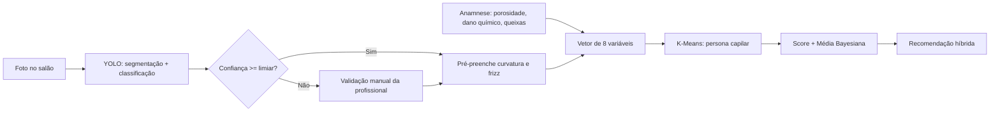

# Relatório de Atualização de Arquitetura e Status — TCC

**Projeto:** Vila Cachos AI — Sistema Especialista B2B para Recomendação Híbrida de Produtos Capilares
**Aluno:** Marcos Vinícius
**Data:** 05/10/2026
**Destinatário:** Prof.(a) Orientador(a)

---

## 1. Resumo Executivo do Status Atual

O Vila Cachos AI encontra-se com seu **núcleo de inteligência validado**: o pipeline composto por anamnese estruturada, clusterização não supervisionada (K-Means) e ranqueamento de produtos com suavização bayesiana está funcional e integrado em uma arquitetura cliente-servidor (React/Vite + FastAPI).

Durante a validação, identificou-se que a principal fonte de incerteza do sistema **não está no modelo de recomendação, mas na entrada de dados**: a classificação manual de variáveis morfológicas (curvatura e frizz) é subjetiva e varia entre profissionais. Para mitigar esse viés, propõe-se a **incorporação de um módulo de Visão Computacional baseado em YOLO**, que automatiza a extração dessas variáveis a partir de imagem capturada no salão.

Com isso, o projeto evolui de um sistema especialista baseado em entrada declarativa para um **sistema híbrido multimodal** (dados tabulares + visão computacional), elevando sua robustez metodológica e sua contribuição científica.

| Componente | Status |
|---|---|
| Anamnese guiada (8 variáveis) | ✅ Validado |
| Clusterização K-Means (4 personas) | ✅ Validado |
| Score de produto + Média Bayesiana | ✅ Validado |
| Front-end (React/Vite) e API (FastAPI) | ✅ Validado |
| Módulo de Visão Computacional (YOLO) | 🔄 Em especificação |

---

## 2. Arquitetura Base Validada

### 2.1 Coleta de Dados
A anamnese captura **8 variáveis**: curvatura (tipos 2 a 4), porosidade, dano químico e 5 queixas capilares. Esses atributos são normalizados e compõem o vetor de características da cliente.

### 2.2 Segmentação via K-Means (Scikit-Learn)
O vetor de características é projetado sobre um modelo K-Means com **k = 4**, atribuindo a cliente a uma de quatro **personas capilares**. A escolha do *k* foi sustentada por métricas de qualidade de agrupamento (método do cotovelo e coeficiente de silhueta), garantindo clusters interpretáveis do ponto de vista do domínio.

### 2.3 Ranqueamento com Média Bayesiana
O score final de cada produto combina a aderência técnica à persona com o feedback dos usuários (notas de 1 a 5). Para evitar distorções causadas por produtos com poucas avaliações, aplica-se a Média Bayesiana:

$$
S_{bayes} = \frac{C \cdot m + \sum_{i=1}^{n} r_i}{C + n}
$$

onde *m* é a média global, *C* o peso de confiança (número mínimo de avaliações) e *n* o número de avaliações do produto. Assim, um produto novo com uma única nota 5 não supera um produto consolidado com centenas de avaliações altas — resolvendo o problema de *cold start* no ranqueamento.

---

## 3. Integração com YOLO (Visão Computacional)

### 3.1 Motivação
O objetivo do módulo é **automatizar a detecção da curvatura e do nível de frizz do cabelo a partir de uma foto tirada no salão, reduzindo o erro humano na etapa de anamnese manual**.

A justificativa para o uso do YOLO (*You Only Look Once*) — em particular versões recentes da família Ultralytics (YOLOv8/YOLO11) — fundamenta-se em:

- **Inferência em tempo real:** arquitetura *single-stage*, adequada ao uso em balcão de atendimento, inclusive em hardware modesto.
- **Versatilidade de tarefas:** suporte nativo a detecção, segmentação de instâncias e classificação, permitindo isolar a região do cabelo e então classificá-la.
- **Transfer learning eficiente:** pesos pré-treinados reduzem a necessidade de grandes volumes de dados rotulados, viável no escopo de um TCC.
- **Ecossistema Python:** integração direta com o back-end FastAPI já existente.

### 3.2 Encaixe no Fluxo de Diagnóstico

- **UC-01 — Realizar Anamnese Capilar:** a profissional captura uma foto; o YOLO segmenta a região capilar e infere a **curvatura (2A–4C)** e o **nível de frizz**, com o respectivo grau de confiança. Esses valores **pré-preenchem** a anamnese. Abaixo de um limiar de confiança, o sistema solicita confirmação humana (*human-in-the-loop*).
- **UC-02 — Gerar Diagnóstico e Recomendação:** as variáveis inferidas compõem o vetor de entrada do K-Means sem alteração no modelo de segmentação, preservando a arquitetura validada. O motor bayesiano permanece inalterado.

### 3.3 Valor Tecnológico e Científico
1. **Redução de subjetividade:** substitui uma avaliação perceptual por uma medição reprodutível, mensurável via concordância entre modelo e especialistas (ex.: Kappa de Cohen).
2. **Arquitetura multimodal:** integra aprendizado supervisionado (visão) com não supervisionado (clusterização) e inferência estatística (bayesiana) em um único pipeline.
3. **Hipótese testável:** permite avaliar experimentalmente se a entrada automatizada melhora a estabilidade da atribuição de personas em relação à entrada manual.
4. **Contribuição de dados:** construção de um dataset rotulado de curvaturas capilares, área com baixa disponibilidade de bases públicas — especialmente para cabelos crespos (tipo 4).

---

## 4. Próximos Passos (Roadmap)

| # | Etapa | Entregável |
|---|---|---|
| 1 | **Construção do dataset** — coleta de imagens (com termo de consentimento/LGPD) e rotulagem de curvatura e frizz (ex.: Roboflow/CVAT), com balanceamento entre tipos 2, 3 e 4 | Dataset versionado + protocolo de rotulagem |
| 2 | **Treinamento do modelo YOLO** — *fine-tuning* a partir de pesos pré-treinados, com *data augmentation* (iluminação, ângulo, fundo) | Pesos treinados (`best.pt`) |
| 3 | **Avaliação do modelo** — mAP, precisão, revocação, F1 por classe, matriz de confusão e concordância com especialistas | Relatório de métricas |
| 4 | **Integração na API** — rota `POST /diagnostico/imagem` no FastAPI (upload, pré-processamento, inferência, retorno JSON com confiança) | Endpoint documentado (OpenAPI) |
| 5 | **Integração no Front-end** — captura/upload de foto no React e pré-preenchimento da anamnese com opção de correção | Tela de captura funcional |
| 6 | **Validação experimental comparativa** — entrada manual vs. automatizada: estabilidade das personas e qualidade da recomendação | Capítulo de resultados |
| 7 | **Atualização da documentação** — diagramas UML, casos de uso e texto da monografia | Monografia revisada |

### Riscos e Mitigações
- **Variação de iluminação e enquadramento:** protocolo padronizado de captura + *augmentation*.
- **Desbalanceamento de classes:** coleta direcionada e ponderação de classes na perda.
- **Baixa confiança do modelo:** mecanismo *human-in-the-loop*, garantindo que o sistema nunca fique pior que a anamnese manual.
- **Privacidade (LGPD):** processamento restrito à região capilar e anonimização/descartes das imagens após inferência, salvo consentimento.

---

Fico à disposição para discutirmos o escopo do módulo de visão computacional e sua adequação ao cronograma do TCC.

Atenciosamente,
**Marcos Vinícius**
