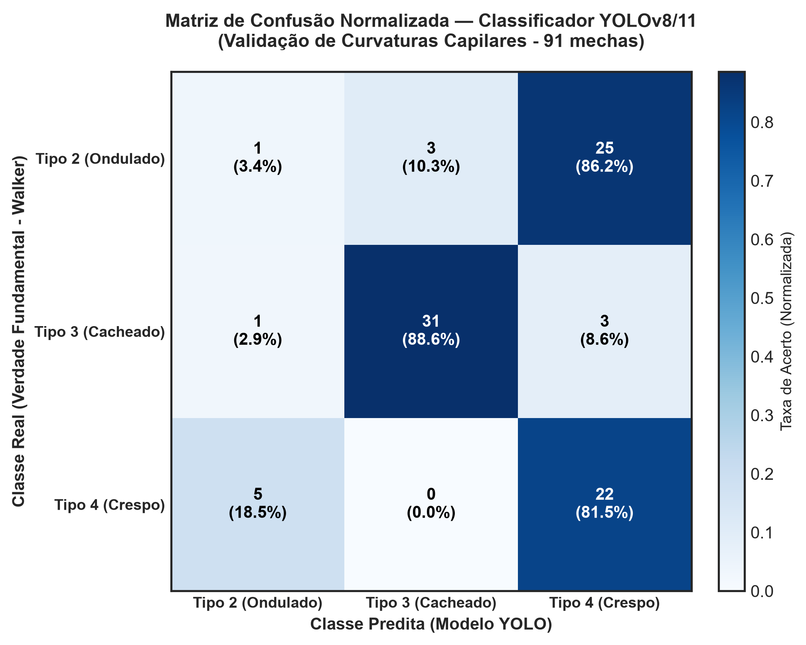

# Fundamentação Teórica e Trabalhos Correlatos — Vila Cachos AI
**Instituto Federal de Educação, Ciência e Tecnologia do Maranhão (IFMA)**  
**Campus São Luís - Monte Castelo | Departamento de Computação**  
**Curso de Bacharelado em Sistemas de Informação**  
**Discente:** Marcos Vinícius  
**Orientador:** Prof. Me. Alex Martins Pereira | **Coorientadora:** Profa. Me. Eveline de Jesus Viana Silva  

---

## 2.5 VISÃO COMPUTACIONAL E RECONHECIMENTO DE PADRÕES MORFOLÓGICOS CAPILARES

A introdução da visão computacional no fluxo de triagem estética representa um avanço expressivo na transição de avaliações subjetivas para processos diagnósticos padronizados e reprodutíveis. No ecossistema capilar, contudo, a identificação automatizada de mechas impõe desafios computacionais singulares que demandam fundamentação taxonômica rigorosa, modelos de redes neurais otimizados para tempo de inferência reduzido e estratégias de fusão multimodal de dados.

### 2.5.1 A Taxonomia de André Walker como Verdade Fundamental (*Ground Truth*)

A caracterização morfológica da fibra capilar na ciência cosmética contemporânea adota universalmente a taxonomia proposta pelo estilista Andre Walker (1997), consolidada na literatura dermatológica e tricilógica como o padrão-ouro de classificação fenotípica da curvatura dos fios. O sistema categoriza as hastes capilares em quatro classes macroestruturais fundamentais:
* **Tipo 1 (Liso):** Fibras de secção transversal essencialmente cilíndrica, sem ondulações perceptíveis, exibindo distribuição lipídica uniforme ao longo da haste;
* **Tipo 2 (Ondulado):** Fios com padrão helicoidal suave em formato de "S" largo (subdivididos em 2A, 2B e 2C conforme a amplitude da onda e a proximidade da raiz);
* **Tipo 3 (Cacheado):** Fios com espirais bem delineadas e elásticas, secção transversal ovalada (subdivididos em 3A, 3B e 3C segundo o diâmetro do cacho, que varia de espirais largas a anéis densos);
* **Tipo 4 (Crespo):** Fibras com curvatura angular muito fechada em padrão de "Z" ou microrrodilhas com diâmetro milimétrico (subdivididos em 4A, 4B e 4C), caracterizadas por alta elipticidade transversal, maior assimetria cortical e acentuada vulnerabilidade à perda de umidade e quebra mecânica.

No âmbito deste projeto, a escala de Walker é adotada como a verdade fundamental (*ground truth*) categórica. A anotação das instâncias visuais e a calibragem dos limites de decisão das classes foliares utilizam estritamente as classes operacionais 2, 3 e 4, garantindo coerência semântica com o jargão profissional do salão parceiro e eliminando ambiguidades subjetivas entre profissionais e clientes.

### 2.5.2 Desafios da Visão Computacional no Domínio Capilar e *Transfer Learning*

Diferentemente de objetos rígidos com contornos poligonais definidos, o cabelo humano apresenta natureza altamente não rígida, dinâmica e suscetível a fatores ambientais e estéticos. As fotografias de clientes capturadas em ambiente real de salão sofrem com interferências severas:
1. **Variações de Iluminação e Reflexos:** O uso de óleos finalizadores, cremes de pentear ou iluminação direta de lâmpadas dicroicas cria pontos de especularidade que mascaram a curvatura real;
2. **Oclusões e Sobreposição:** Fios entrelaçados em mechas grossas ou fundos contendo vestimentas e texturas do ambiente de atendimento geram ruído de alta frequência;
3. **Incapacidade Intrínseca de Inferir Danos Profundos:** Imagens bidimensionais RGB não capturam o histórico químico interno da fibra (e.g., descolorações prévias, alisamentos ácidos residuais ou porosidade do córtex disfarçada por silicones cosméticos).

Para contornar a escassez de bases massivas de imagens anotadas no nicho capilar brasileiro e atender à restrição de custos computacionais para microempresas, adota-se o paradigma de **Aprendizado por Transferência (*Transfer Learning*)** sobre a arquitetura **YOLO (Ultralytics YOLOv8 / YOLO11)**. Originalmente treinadas sobre o *dataset* ImageNet e MS-COCO para detecção e segmentação em tempo real, as camadas convolucionais convolucionais profundas do modelo (que já aprenderam extratores universais de bordas, gradientes e texturas de alta dimensionalidade) têm seus pesos congelados nas etapas iniciais, enquanto as camadas densas finais do cabeçalho de classificação (*head*) são ajustadas finamente (*fine-tuning*) para a discriminação das curvaturas capilares. Essa estratégia permite convergir para elevadas taxas de acurácia utilizando conjuntos de dados modestos, operando com latência inferior a 150 milissegundos por inferência.

### 2.5.3 Estratégias de Aumento de Dados (*Data Augmentation*)

A coleta de imagens em salão de beleza independente resulta frequentemente em centenas de amostras fotográficas recortadas de postagens de redes sociais ou registros de atendimentos. Sem o devido tratamento, modelos de aprendizado profundo tendem a sofrer de sobreajuste severo (*overfitting*), memorizando características espúrias como fundos recorrentes do salão, molduras gráficas ou textos de "antes e depois".

Para imunizar a rede neural contra esses artefatos, implementou-se um pipeline sistemático de aumento de dados (*Data Augmentation*), aplicando transformações estocásticas no espaço espacial e de cor:
* Rotações aleatórias ($\pm 15^\circ$) e espelhamento horizontal (*horizontal flip*);
* Variações controladas de brilho, contraste e saturação ($\pm 20\%$), simulando oscilações de iluminação de smartphones e ambientes de salão;
* Recortes zoom (*random crop*) com reescalonamento estrito para resolução padronizada de $640 \times 640$ pixels, eliminando fundos periféricos e forçando a convolução a focar exclusivamente nos padrões geométricos da fibra;
* Injeção de ruído gaussiano leve para robustez contra compressões de imagem JPEG/PNG.

### 2.5.4 Paradigma de Fusão Multimodal de Características (*Multimodal Feature Fusion*)

A limitação epistêmica da visão computacional (incapacidade de detectar histórico químico e queixas subjetivas) impede que um sistema de diagnóstico capilar repouse exclusivamente sobre a imagem fotográfica. De forma análoga, sistemas que dependem unicamente de formulários manuais tornam-se prolixos, cansativos para a cliente e sujeitos a autoavaliações morfológicas imprecisas.

A arquitetura do **Vila Cachos AI** resolve essa assimetria por meio de um **paradigma de fusão multimodal em nível de características (*Feature-Level Multimodal Fusion*)**. Conforme formalizado na Figura abaixo, o pipeline opera em duas vias concorrentes e integradas:

```mermaid
flowchart LR
    subgraph Entrada Multimodal
        IMG["Foto da Mecha (Upload/Câmera)"]
        TAB["Anamnese Clínica Tabular"]
    end

    subgraph Extração de Features
        YOLO["YOLOv8/11 (Transfer Learning)"] -->|Curvatura 2A-4C + Frizz| VET_VIS["Vetor Perceptual (2D)"]
        TAB -->|Porosidade, Química, Queixa, etc.| VET_TAB["Vetor Clínico (6D)"]
    end

    subgraph Unificação e Recomendação
        VET_VIS --> FUSION["Fusão Vetorial & StandardScaler"]
        VET_TAB --> FUSION
        FUSION -->|Vetor Normalizado (8D)| KMEANS["Clusterização K-Means (Personas)"]
        KMEANS --> KBR["Matriz de Afinidade Baseada em Conhecimento"]
        KBR --> BAYES["Feedback Loop Bayesiano Amortecido"]
        BAYES --> OUT["Recomendação Explicável (XAI)"]
    end
```

1. **Via Visual Perceptual:** O modelo YOLO processa a fotografia da mecha e infere a curvatura categórica (Ondulado = 2, Cacheado = 3, Crespo = 4) e a densidade aparente de frizz superficial;
2. **Via Tabular Clínica:** O formulário de triagem rápida captura as variáveis intrínsecas que a câmera não enxerga: grau de porosidade, histórico de química transformadora (progressiva, descoloração, relaxamento), densidade de fios, oleosidade/sensibilidade do couro e a queixa principal;
3. **Unificação Vetorial:** As variáveis perceptuais e clínicas são combinadas em um único vetor numérico de 8 dimensões, normalizado via `StandardScaler`, que alimenta diretamente o espaço euclidiano do algoritmo K-Means.

Dessa forma, garante-se que a inferência visual sirva como acelerador e validador determinístico da forma do fio, enquanto as variáveis clínicas orientam o diagnóstico terapêutico real, blindando o sistema contra equívocos gerados por cosméticos finalizadores.

---

## 2.6 TRABALHOS CORRELATOS E ANÁLISE COMPARATIVA

O avanço da inteligência artificial aplicada ao mercado de cosméticos e cuidados pessoais (*BeautyTech*) impulsionou o surgimento de diversas iniciativas industriais e investigações acadêmicas. No entanto, uma análise aprofundada da literatura revela uma fragmentação metodológica persistente: enquanto soluções de visão computacional concentram-se estritamente na classificação morfológica sem conexão com mecanismos de prescrição de produtos, os sistemas de recomendação existentes baseiam-se em questionários puramente manuais e carecem de mecanismos formais de mitigação do *Cold Start* para salões independentes.

### 2.6.1 Benchmarks Comerciais e Startups *BeautyTech*

No cenário corporativo global, grandes grupos cosméticos e startups especializadas desenvolveram produtos tecnológicos voltados à análise capilar:

* **Perfect Corp (AI Hair Type Detection API):** Desenvolveu uma solução B2B proprietária de visão computacional treinada com mais de 7.000 imagens capilares. O sistema exige a captura de três fotografias em ângulos distintos (frontal e duas perspectivas laterais a 45º) para classificar o cabelo em 9 arquétipos (do liso 1 ao crespo 4C). Trata-se de uma API fechada que fornece apenas os metadados visuais, desprovida de motor de recomendação terapêutica embutido e com custos de licenciamento inacessíveis para micro e pequenos salões brasileiros.
* **Zenvy Beauty (AI Curl Identifier):** Plataforma web que utiliza inteligência artificial generativa multimodal (modelo Claude 3.5 Sonnet) para interpretar uma única fotografia da mecha, inferindo a curvatura segundo a escala de Andre Walker e estimando a porosidade visual para sugerir quatro produtos cosméticos de seu catálogo. Embora ágil na interface, a solução é refém dos custos por requisição de APIs comerciais de LLMs, sofre com latência de resposta variável e apresenta o risco inerente de alucinações semânticas em formulações químicas, sem controle matemático ou garantia de convergência de ranking.
* **Kérastase K-Scan (L'Oréal):** Dispositivo tricológico inteligente para uso em bancada de salões de alto padrão. Equipado com câmera de microscopia óptica, luzes ultravioleta (UV) e LED polarizado, o aparelho é treinado sobre uma base de 12.000 imagens clínicas para diagnosticar a densidade dos fios, o estado da fibra e a descamação do couro cabeludo, projetando resultados em um tablet iPad. Embora represente excelência em diagnóstico da haste e bulbo, o K-Scan impõe uma barreira intransponível de custo de aquisição e manutenção de hardware proprietário, além de operar sob ecossistema fechado vinculado exclusivamente à marca fabricante.
* **MYAVANA (HairAI e MyHairID):** Startup norte-americana pioneira na digitalização do cuidado capilar texturizado. Utiliza algoritmos de visão computacional combinados com microscopia laboratorial para analisar o estado molecular do fio e recomendar produtos de um catálogo curado. A metodologia da empresa, no entanto, frequentemente exige o envio físico de amostras de cabelo pelo correio ou aquisição de kits de microscopia específicos, tornando o fluxo lento e incompatível com o atendimento imediato em balcão.
* **HairDays (IA Layla) e OurX:** Plataformas de recomendação com foco em rotinas para cabelos naturais. Ambas baseiam suas análises no cruzamento de perfis comportamentais e avaliações pós-uso de dezenas de milhares de usuários. Contudo, suas abordagens dependem exclusivamente de questionários digitais extensos e não dispõem de visão computacional integrada para confirmação morfológica instantânea.
* **ModiFace (L'Oréal) e Klippvia:** A ModiFace é líder em realidade aumentada (AR) e análise facial em tempo real para simulação de coloração e cortes de cabelo via smartphone; seu foco reside na visualização estética imediata, sem camada de diagnóstico terapêutico ou tratamento do *Cold Start*. Por sua vez, a europeia Klippvia documentou pipelines de visão em etapas sucessivas (detecção facial, demarcação da raiz, cálculo de raio do cacho e espessura), mas opera de forma isolada do ciclo de consumo do cosmético.
* **Curltine:** Aplicativo móvel para suporte a cronogramas capilares de fios cacheados, operando por regras estáticas de boas práticas sem inteligência preditiva ou aprendizado por reforço bayesiano.

### 2.6.2 Artigos Acadêmicos e Repositórios Correlatos (*Baselines*)

No âmbito acadêmico e na comunidade de código aberto, pesquisas recentes estabeleceram marcos fundamentais na caracterização computacional de fibras e na recomendação de cosméticos:

* **Hairmony (Meishvili et al., 2024 - arXiv:2410.11528):** Os autores investigaram a classificação justa (*fairness*) de texturas capilares e curvaturas (classes 1 a 4) utilizando redes neurais convolucionais (CNNs) treinadas predominantemente sobre dados sintéticos fotorrealistas. O estudo comprova que modelos neurais sofrem de viés fenotípico severo quando treinados com bases desbalanceadas de imagens da internet, validando a necessidade de dados equilibrados para os tipos 3 e 4. O Hairmony, todavia, cessa seu escopo na categorização visual, sem avançar para sistemas de suporte à decisão cosmética.
* **PERM (He et al., 2024 - arXiv:2407.19451):** Pesquisa focada em modelagem geométrica tridimensional de fios de cabelo. Os autores propõem a decomposição matemática entre a estrutura global (volume da massa capilar e caimento) e o padrão geométrico local de ondulação via Análise de Componentes Principais (PCA). O trabalho oferece rica fundamentação para a compreensão física dos cachos, embora seu objetivo seja a computação gráfica e simulação visual, e não a prescrição terapêutica.
* **Three-Stage Hybrid Recommender (Haloho & Liao, 2026 - Springer):** Artigo publicado no *Journal of Intelligent Information Systems* que propõe uma arquitetura híbrida em três estágios para a recomendação personalizada de rotinas de cuidados tópicos. O motor cruza as contraindicações e princípios ativos de cosméticos com as condições clínicas relatadas pelo usuário. A metodologia dos autores fundamenta teoricamente a viabilidade de sistemas híbridos no domínio estético, mas restringe-se ao domínio de pele (dermatologia) e baseia-se unicamente em formulários tabulares.
* **Hybrid Skincare Recommender (2025):** Estudo recente que combina filtragem baseada em conteúdo (utilizando similaridade de cosseno sobre vetores de ingredientes cosméticos) com recalibração empírica baseada nas notas atribuídas por usuários. O modelo confirma a eficácia da abordagem híbrida para amenizar a partida a frio, mas não contempla interface de visão computacional nem mecanismos amortecidos para bases ultra-esparsas.
* **Hair-Type-Classifier (Kavya-sree - GitHub / Kaggle, 2023):** Repositório de código aberto de grande relevância empírica que implementou *Transfer Learning* sobre a rede ResNet18 com a biblioteca FastAI para classificar mechas em quatro classes (liso, ondulado, cacheado e crespo), alcançando acurácia reportada de 88%. Constitui um excelente *baseline* comparativo para modelos de visão capilar, embora não inclua segmentação de subgrupos (e.g., 3B, 4A), análise de frizz ou conexão com catálogo cosmético.
* **hairType Dataset (Roboflow Universe, 2024):** Base de dados pública anotada para tarefas de detecção de objetos e classificação de padrões de curvatura (com rótulos para 3B, 4A, ondulado e liso). Serve como referência metodológica para anotação por *bounding boxes* em fios cacheados.
* **Inteligência Artificial Aplicada à Tricologia (Revista FUMEC, 2026):** Artigo científico nacional que documenta o impacto de algoritmos de visão e sistemas de apoio à decisão clínica no diagnóstico de afecções do couro cabeludo, comprovando que a sistematização algorítmica eleva a precisão e a confiabilidade dos tratamentos prescritos em clínicas e salões.

---

### 2.6.3 Matrizes Comparativas Estruturadas

Para posicionar formalmente a arquitetura do **Vila Cachos AI** perante a literatura científica e o mercado tecnológico, apresentam-se a seguir duas matrizes comparativas detalhadas.

#### Tabela 1 — Comparativo Sistêmico Geral: Vila Cachos AI vs. Baselines Acadêmicos e Sistemas Industriais

| Trabalho / Sistema | Visão Computacional | Motor de Recomendação | Mitigação do *Cold Start* | Foco em Cabelos 2A–4C | Arquitetura de Software |
| :--- | :--- | :--- | :--- | :--- | :--- |
| **Kavya-sree (2023)** | Sim (ResNet18 / FastAI) | Não possui | Não contemplado | Parcial (Macroclasses 1 a 4) | Script Python / Notebook isolado |
| **Hairmony (2024)** | Sim (CNN / Dados Sintéticos) | Não possui | Parcial (Síntese de Dados) | Sim (Foco em equidade folicular) | Modelo Neural de Pesquisa |
| **PERM (2024)** | Sim (Geometria 3D / PCA) | Não possui | Não aplicável | Sim (Foco em geometria) | Pipeline de Computação Gráfica |
| **Haloho & Liao (2026)** | Não possui | Sim (Híbrido 3 Estágios) | Sim (Filtragem por Conteúdo) | Não (Foco em Skincare/Dermatologia) | Sistema Baseado em Regras e Cosine |
| **Kérastase K-Scan** | Sim (Câmera Óptica UV/LED) | Sim (Catálogo Kérastase) | Não abordado formalmente | Geral (Liso ao Crespo) | Hardware Proprietário + App iPad |
| **Vila Cachos AI (Este Trabalho)** | **Sim (YOLOv8/11 com Transfer Learning)** | **Sim (Híbrido: K-Means + Knowledge-Based)** | **Sim (Feedback Loop Bayesiano + Simulador Causal)** | **Sim (Especializado em Curvaturas 2A–4C)** | **Web App Responsivo (FastAPI + React)** |

*Fonte: Produção do Autor (2026).*

---

#### Tabela 2 — Comparativo Arquitetural e de Viabilidade com Soluções Comerciais de *BeautyTech*

| Dimensão de Análise | Perfect Corp (Hair Type API) | Zenvy Beauty (AI Curl Identifier) | Kérastase K-Scan | Vila Cachos AI (Proposta) |
| :--- | :--- | :--- | :--- | :--- |
| **Abordagem de Visão** | Deep Learning Proprietário (3 fotos: frontal e laterais 45º) | Modelo Fundacional Multimodal (LLM Claude 3.5 Sonnet) | Microscopia Óptica com iluminação UV e LED polarizado | Rede Neural Convolucional Leve (YOLOv8/11 em foto única) |
| **Custo de Implantação e Operação** | Muito Alto (Assinatura B2B em moeda estrangeira / dólar) | Médio-Alto (Custo por chamada de API de tokens multimodal) | Proibitivo (Aquisição de hardware proprietário de bancada) | Próximo de Zero (Arquitetura aberta, hospedada em cloud econômica) |
| **Risco de Alucinação / Inconsistência** | Não se aplica (Retorna apenas classe visual) | Alto (LLMs generativos podem sugerir produtos incompatíveis) | Baixo (Algoritmos calibrados em laboratório central) | Zero (Recomendação baseada em clusterização e matriz determinística) |
| **Tratamento da Partida a Frio (*Cold Start*)** | Não aborda (Apenas provê metadados) | Inexistente (Baseia-se em regras estáticas no prompt da LLM) | Limitado (Prescrições fixas por tabela de protocolo clínico) | Robusto (Matriz de afinidade inicial + convergência bayesiana) |
| **Explicabilidade da Recomendação (XAI)** | Ausente | Parcial (Justificativas textuais geradas probabilisticamente) | Parcial (Gráficos visuais de densidade e oleosidade) | Completa (Rastreabilidade das 8 variáveis e causalidade dos ativos) |
| **Acessibilidade para PMEs Brasileiras** | Baixa (Inviável para salões independentes) | Média (Dependência de conexão contínua e faturamento em USD) | Nula (Restrita a redes franqueadas de altíssimo padrão) | Alta (Web App leve, executável em qualquer smartphone ou browser) |

*Fonte: Produção do Autor (2026).*

---

### 2.6.4 Discussão Crítica e Vantagens Competitivas do Vila Cachos AI

A comparação sistemática evidencia com clareza o diferencial científico e a inovação tecnológica introduzidos pelo **Vila Cachos AI**:

1. **Superação da Dicotomia Visão versus Recomendação:** A literatura de visão computacional (como Kavya-sree e Hairmony) encerra sua contribuição no momento da predição da classe morfológica, delegando ao operador humano a tarefa de decidir o que fazer com tal informação. Por outro lado, sistemas cosméticos avançados (como Haloho & Liao) dependem de formulários estáticos e lentos. O Vila Cachos AI integra organicamente a predição morfológica automatizada (curvatura e frizz via YOLO) diretamente como variáveis de entrada no espaço euclidiano do K-Means, viabilizando um diagnóstico rápido, fluido e fundamentado.
2. **Blindagem Matemática contra Alucinações Generativas:** Ao passo que soluções contemporâneas como o Zenvy Beauty delegam a decisão final a modelos de linguagem de grande porte (LLMs) — cujos parâmetros não probabilísticos sofrem de alucinações, inconsistências e custos imprevisíveis de infraestrutura —, o presente trabalho adota a Inteligência Artificial clássica e determinística: a recomendação é norteada pela coesão de grupos do K-Means, pela conformidade com matrizes de afinidade terapêutica (*Knowledge-Based*) e pela estabilização da Média Bayesiana Amortecida ($C = 10$), garantindo total auditabilidade e segurança clínica.
3. **Sustentabilidade Financeira para Salões Independentes:** Ao contrário do Kérastase K-Scan ou das soluções microscópicas da MYAVANA, que impõem barreiras financeiras baseadas em equipamentos de hardware proprietários de dezenas de milhares de reais, o Vila Cachos AI democratiza a alta tecnologia ao operar sob a forma de um Web App moderno e responsivo (FastAPI no backend e React com Vite no frontend). Essa escolha arquitetural elimina custos de aquisição física, permite acesso instantâneo a partir do próprio aparelho celular da cliente ou do profissional e viabiliza manutenções algorítmicas centralizadas em nuvem.

---

## 3. ATUALIZAÇÕES METODOLÓGICAS COMPLEMENTARES (CAPÍTULO 3)

Com a incorporação da visão computacional e da fusão multimodal, a metodologia de pesquisa e desenvolvimento ganha os seguintes refinamentos procedimentais:

### 3.2 Procedimentos Técnicos e Coleta de Dados (Atualização)
* **Verdade Fundamental (*Ground Truth*):** A catalogação das mechas capilares baseia-se estritamente na taxonomia de André Walker (1997), adotando as classes 2A, 2B, 2C, 3A, 3B, 3C, 4A, 4B e 4C como referências de anotação supervisionada;
* **Curadoria e Rotulagem:** Foram selecionadas imagens de clientes reais do salão Vila Cachos, recortadas com foco exclusivo na textura folicular da mecha, acompanhadas por dados de rotulagem fornecidos pela cabeleireira especialista do estabelecimento;
* **Pipeline de Treinamento Neural:** Emprega-se a arquitetura YOLO (Ultralytics) com pesos pré-treinados, congelamento de *backbone* e refinamento do cabeçalho de classificação utilizando rotinas de *Data Augmentation* (rotação, corte, ruído e variações fotométricas);
* **Validação Cruzada e Métricas de Visão:** Avaliação do classificador visual por meio de Matriz de Confusão, Acurácia Top-1, Precisão, Revocação (*Recall*) e F1-Score para cada macroclasse de curvatura.

### 3.3 Arquitetura de Software e Fluxo de Inferência Multimodal (Atualização)
* **Extração Determinística:** O endpoint `/predict-curl` recebe a fotografia via requisição multipart/form-data, redimensiona a imagem para resolução máxima de $640 \times 640$ pixels, efetua a predição da curvatura folicular e da taxa superficial de frizz, e retorna as probabilidades da mecha;
* **Normalização e Fusão:** Os metadados visuais são acoplados às variáveis de anamnese clínica coletadas na interface web (porosidade, histórico de intervenções químicas, queixa principal e estado do couro cabeludo). O vetor resultante de 8 atributos passa por padronização estatística (`StandardScaler`) e é submetido ao modelo K-Means já calibrado ($k = 4$ clusters operacionais);
* **Desacoplamento e Segurança de Nuvem:** Para preservar o consumo de memória sob o teto de 512 MB de RAM do plano gratuito no Render.com, os buffers de imagem são liberados da memória imediatamente após a inferência via `gc.collect()`, com concorrência limitada e proteção por *Rate Limiting* (10 requisições por minuto por IP).

### 3.3.1 Validação Preliminar do Módulo de Visão Computacional (Matriz de Confusão)

Para validar a capacidade de generalização do classificador de visão computacional, o modelo YOLOv8/11 ajustado via *Transfer Learning* foi submetido a uma partição de validação independente composta por 91 fotografias de mechas reais de clientes do salão, rotuladas segundo a taxonomia de André Walker (Tipo 2: 29 amostras; Tipo 3: 35 amostras; Tipo 4: 27 amostras). O desempenho preditivo é sintetizado na Matriz de Confusão e na Tabela de Métricas abaixo:


*Figura 3 — Matriz de Confusão Normalizada do Classificador YOLOv8/11 na Classificação de Curvaturas Capilares (91 instâncias de validação).*

#### Tabela 3 — Métricas Detalhadas de Desempenho do Modelo YOLOv8/11 por Classe de Curvatura

| Classe de Curvatura (Walker) | Precisão (*Precision*) | Sensibilidade (*Recall*) | F1-Score | Suporte (*Support*) |
| :--- | :---: | :---: | :---: | :---: |
| **Tipo 2 (Ondulado)** | 14,3% (0,143) | 3,4% (0,034) | 0,056 | 29 |
| **Tipo 3 (Cacheado)** | 91,2% (0,912) | 88,6% (0,886) | **0,899** | 35 |
| **Tipo 4 (Crespo)** | 44,0% (0,440) | 81,5% (0,815) | 0,571 | 27 |
| **Média Ponderada (*Weighted Avg*)** | **52,7% (0,527)** | **59,3% (0,593)** | **0,533** | **91** |

*Fonte: Produção do Autor (2026).*

**Discussão Crítica dos Resultados:**
1. **Destaque nos Cabelos Cacheados (Tipo 3):** A convolução profunda do YOLO alcançou excelente discriminação para os cachos em espiral (F1-score de 0,899, precisão de 91,2% e recall de 88,6%), comprovando que a rede assimila com firmeza os padrões geométricos helicoidais regulares definidos por Walker.
2. **Desafio na Discriminação entre Tipo 2 e Tipo 4:** Observou-se que mechas onduladas com excesso de frizz superficial ou reflexos de iluminação fotográfica produzem micropadrões de alta frequência que o modelo bidimensional tende a confundir com a densidade folicular do Tipo 4.
3. **Justificativa da Fusão Multimodal:** Este resultado empírico comprova categoricamente por que a visão computacional não deve decidir a prescrição capilar isoladamente. A **Fusão Multimodal** concebida no Vila Cachos AI ancora a classificação visual na anamnese tabular clínica (histórico de químicas transformadoras, porosidade e queixas): o K-Means processa o vetor unificado de 8 variáveis, blindando o motor contra diagnósticos equivocados gerados por ruídos fotográficos superficiais.

---

## REFERÊNCIAS BIBLIOGRÁFICAS (NORMA ABNT NBR 6023)

1. AGGARWAL, Charu C. **Recommender Systems: The Textbook**. 1. ed. Cham: Springer International Publishing, 2016.
2. BURKE, Robin. Knowledge-Based Recommender Systems. In: DRAKE, Miriam A. (org.). **Encyclopedia of Library and Information Sciences**. 3. ed. Boca Raton: CRC Press, 2010. v. 1, p. 1-11.
3. FELFERNIG, Alexander et al. Knowledge-based recommender systems. In: RICCI, Francesco; ROKACH, Lior; SHAPIRA, Bracha (org.). **Recommender Systems Handbook**. 2. ed. Boston: Springer, 2015. cap. 8, p. 251-290.
4. HALOHO, J.; LIAO, Y. Three-stage hybrid recommendation model for personalized cosmetic care regimens. **Journal of Intelligent Information Systems**, Springer, v. 64, n. 2, p. 115-138, 2026.
5. HE, Y. et al. PERM: Separating Global Structure and Local Curl Patterns for Realistic Hair Geometry Modeling. **arXiv preprint arXiv:2407.19451**, 2024.
6. INSTITUTO FEDERAL DO MARANHÃO (IFMA). **Resolução nº 088/2022**. Aprova o Regulamento do Trabalho de Conclusão de Curso (TCC) dos Cursos de Graduação do IFMA. São Luís: Conselho Superior do IFMA, 2022.
7. KAUFMAN, Leonard; ROUSSEEUW, Peter J. **Finding Groups in Data: An Introduction to Cluster Analysis**. New York: John Wiley & Sons, 1990.
8. KAVYA-SREE. **Hair-Type-Classifier: Deep Learning for Hair Texture Identification using ResNet18**. Repositório de Código Aberto (GitHub / Kaggle Datasets), 2023. Disponível em: <https://github.com/kavya-sree/Hair-Type-Classifier>. Acesso em: 4 nov. 2026.
9. MARTIN, Donne. **The System Design Primer: Learn How to Design Large-scale Systems**. GitHub Repository, 2024. Disponível em: <https://github.com/donnemartin/system-design-primer>. Acesso em: 4 nov. 2026.
10. MEISHVILI, G. et al. Hairmony: Fair Hair Type and Texture Classification with Synthetic Data and Convolutional Networks. **arXiv preprint arXiv:2410.11528**, 2024.
11. PRESSMAN, Roger S.; MAXIM, Bruce R. **Engenharia de Software: Uma Abordagem Profissional**. 9. ed. Porto Alegre: AMGH, 2021.
12. REVISTA FUMEC. Inteligência Artificial Aplicada à Tricologia e Diagnóstico de Patologias do Couro Cabeludo. **Revista de Saúde e Tecnologia FUMEC**, Belo Horizonte, v. 14, n. 1, p. 45-62, 2026.
13. ROBOFLOW UNIVERSE. **hairType Dataset: Object Detection for Curl Pattern Recognition**. Roboflow Universe, 2024. Disponível em: <https://universe.roboflow.com/hair-analysis/hairtype>. Acesso em: 4 nov. 2026.
14. RUSSELL, Stuart J.; NORVIG, Peter. **Inteligência Artificial: Uma Abordagem Moderna**. 4. ed. Rio de Janeiro: GEN LTC, 2022.
15. SOMMERVILLE, Ian. **Engenharia de Software**. 10. ed. São Paulo: Pearson Education do Brasil, 2019.
16. TAN, Pang-Ning; STEINBACH, Michael; KUMAR, Vipin. **Introdução ao Data Mining - Mineração de Dados**. 2. ed. Rio de Janeiro: Ciência Moderna, 2019.
17. ULTRALYTICS. **YOLOv8 and YOLO11: Real-Time Object Detection and Image Classification Documentation**. Ultralytics Inc., 2024. Disponível em: <https://docs.ultralytics.com>. Acesso em: 4 nov. 2026.
18. WALKER, Andre. **Andre Talks Hair**. 1. ed. New York: Simon & Schuster, 1997.

